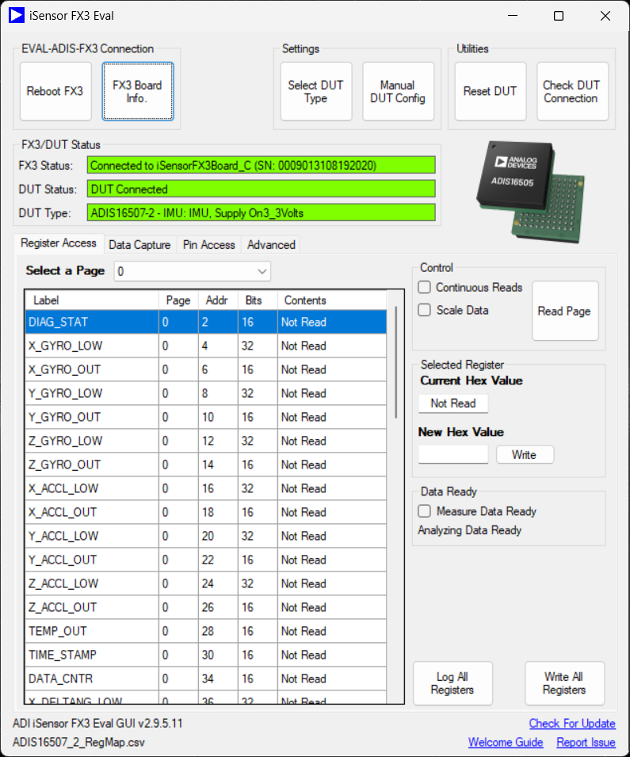
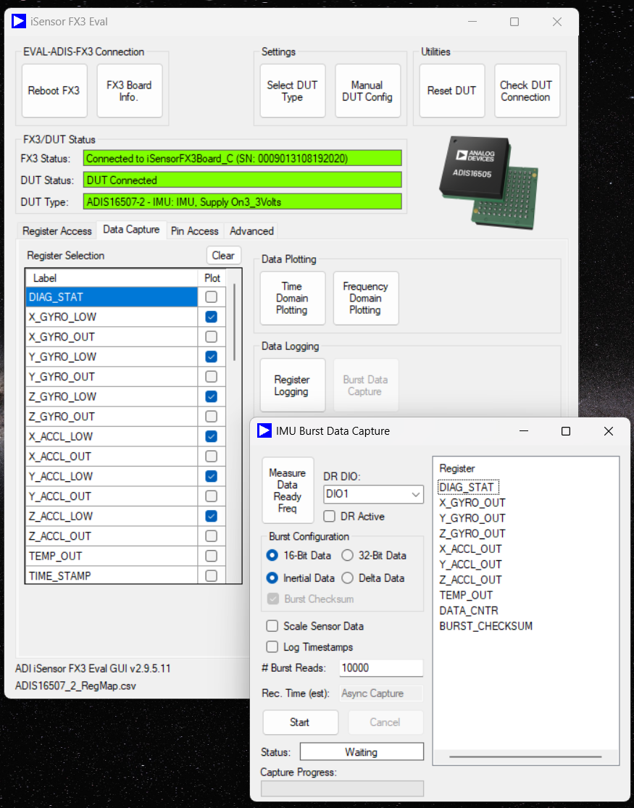

# Research handoff — FX3 connectivity

Snapshot of the `qt-port/research` branch as of 2026-10-10, written when the goal pivoted from
a Qt port of the eval GUI to **integrating FX3 connectivity into a Python application**.
Start here; follow links only as needed. Index of everything: [README.md](README.md).

## What exists

| Artifact | What it is | Status |
|---|---|---|
| [RECOVERED_PROTOCOL.md](RECOVERED_PROTOCOL.md) | 42 vendor opcodes, endpoints, all enums, device product strings, assembly identities, upstream build provenance, FX3Api control-transfer quirks | Verified twice against `FX3Api.dll` 2.9.5.0 |
| [LEGACY_APP_BEHAVIOUR.md](LEGACY_APP_BEHAVIOUR.md) | What the VB app does above USB: config file formats, connect flow, DUT check, **per-family burst rules**, logger format | From source, with line refs |
| [tools/cyusb-shim/](../tools/cyusb-shim) | Replaces `CyUSB` / `FX3USB` / `Microsoft.VisualBasic` so ADI's closed .NET stack runs on macOS/Linux under Mono over libusb, tracing every USB transfer | `FX3Connection` constructs and enumerates on macOS ARM64. **Never run against hardware** |
| [QT_PORT_DESIGN.md](QT_PORT_DESIGN.md) | Licensing audit, feature inventory, Qt/C++ architecture with pluggable IMU descriptors, binary-analysis method | Design only. Parts 0, 1, 6 apply regardless of language |
| [decompile.sh](decompile.sh) | Regenerates decompiler listings locally (git-ignored) | Run on demand |

Upstream (`analogdevicesinc/iSensor-FX3-Eval`) is the `upstream` remote; `master` mirrors it and
was in sync at `42d7b95` / `v2.9.5.11-pub`.

## Observed setup (2026-10-10)

The official Windows GUI working against real hardware:

| | |
|---|---|
| GUI | iSensor FX3 Eval v2.9.5.11 (= upstream release in this repo) |
| Board | `iSensorFX3Board_C`, SN `0009013108192020` |
| DUT | **ADIS16507-2** (ADIS1650x family), personality `ADIS16507-2`, map `ADIS16507_2_RegMap.csv` |
| Supply | 3.3 V |
| Burst config | 16-bit, inertial, checksum on, 10 000 reads, DR on DIO1 |

For this DUT the legacy stack uses `adbfInterface` (standard IMU) and the ADIS1650x burst rules:
command `[0x68, 0x00]`, 22 bytes clocked, first word dropped, 20-byte payload
`DIAG_STAT, X/Y/Z_GYRO_OUT, X/Y/Z_ACCL_OUT, TEMP_OUT, DATA_CNTR, BURST_CHECKSUM`
([LEGACY_APP_BEHAVIOUR.md §3](LEGACY_APP_BEHAVIOUR.md)). SPI mode 3, 1 MHz, 16 µs stall.

## Facts that constrain any approach

- All ADI/Cypress DLLs are managed .NET. Only `CyUSB.dll` (Cypress, proprietary, Windows driver)
  and `FX3USB.dll` touch Win32. Everything else is portable as-is.
- `adisApi.dll` / `adisInterface.dll` are closed-source ADI binaries (no public source). They hold
  the DUT register-access logic (paging, 32-bit word order, automotive SPI CRC, ADcmXL framing).
  For a single standard IMU like ADIS16507-2 that logic is comparatively small.
- **Recovered so far: opcodes, not payloads.** We know *which* vendor command does what, not the
  byte layout of each request/response. Sources for payloads, best first:
  1. USB capture of the official app on the Windows machine above (real, current)
  2. The only public API/firmware source, [xsparc/iSensor-FX3-API](https://github.com/xsparc/iSensor-FX3-API)
     — MIT, but frozen in 2020 while the shipped DLL is from 2025; ADI's own repo is not public
  3. Local decompiler listings of `FX3Api` (`research/decompile.sh`)
- `FX3Api` reports fast-failing control transfers as **success** (RECOVERED_PROTOCOL.md,
  `XferControlData` quirks). Don't inherit that.
- A factory-blank board needs flash/EEPROM programming the shim does not implement. The observed
  board is already programmed.

## Python integration — options as understood at handoff (undecided)

1. **pythonnet + existing `FX3ApiWrapper`, on Windows.** Already supported upstream —
   [src_wrapper/examples/Python/](../src_wrapper/examples/Python) — and the screenshots show the
   underlying stack working on this hardware today. Zero new code; Windows-only; depends on the
   Cypress driver and closed ADI DLLs.
2. **pythonnet on Mono + the cyusb-shim, on macOS/Linux.** Same Python API as (1), cross-platform.
   Unverified on two counts: pythonnet-on-Mono with this stack, and the shim against hardware.
   Still ships closed ADI binaries plus an unsigned CyUSB lookalike — fine for internal tooling,
   questionable for distribution.
3. **Native Python over pyusb/libusb**, built from RECOVERED_PROTOCOL.md + LEGACY_APP_BEHAVIOUR.md.
   No .NET, no closed binaries, cleanest long-term. Work: payload formats for the commands actually
   used, plus `adbfInterface`-equivalent register access for ADIS1650x. Scope is bounded if the app
   needs one DUT family.

Captures from (1) via USBPcap/Wireshark — or traces from (2) — are the reference to build and test (3) against.

## First things to check when resuming

- Which features the Python app needs (register R/W only? burst streaming? GPIO/PWM?) and whether
  ADIS16507-2 is the only DUT — together these decide how much of `adisInterface` must be reproduced.
- Target OS(es) for the Python app — Windows-only collapses the problem to option 1.
- ~~Whether a board is available~~ — yes, see above.
